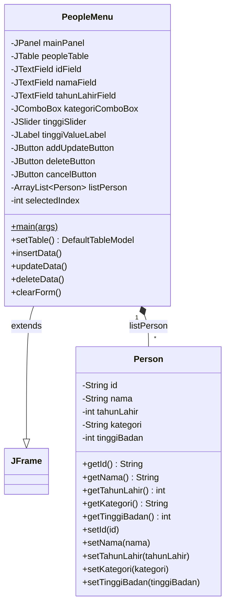
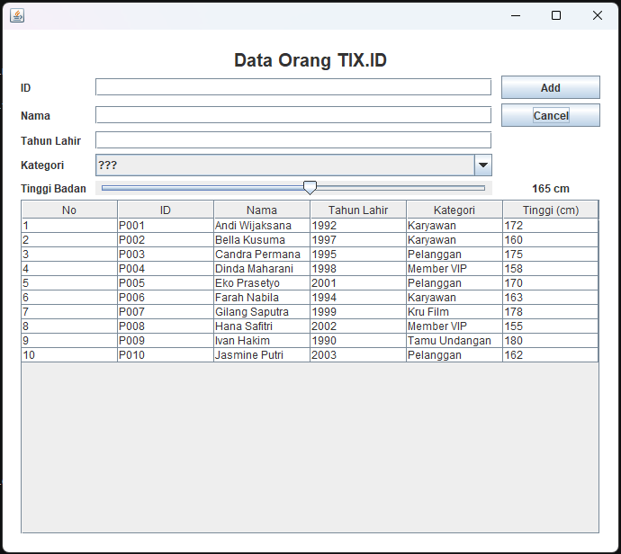
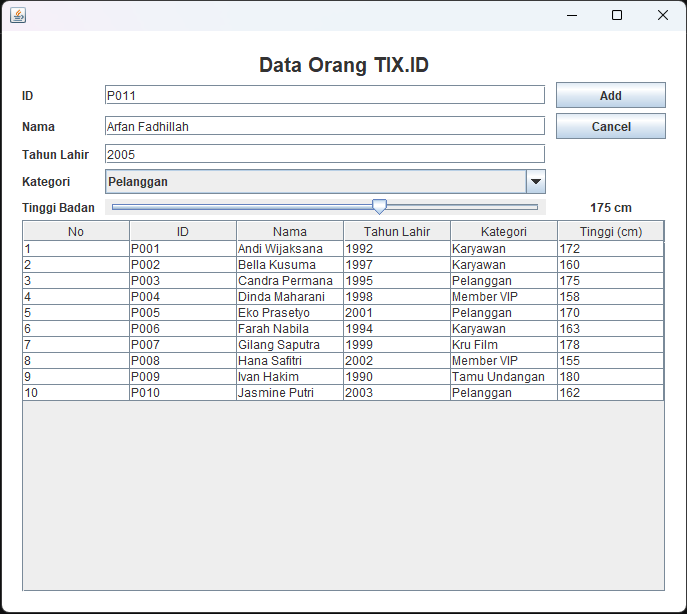
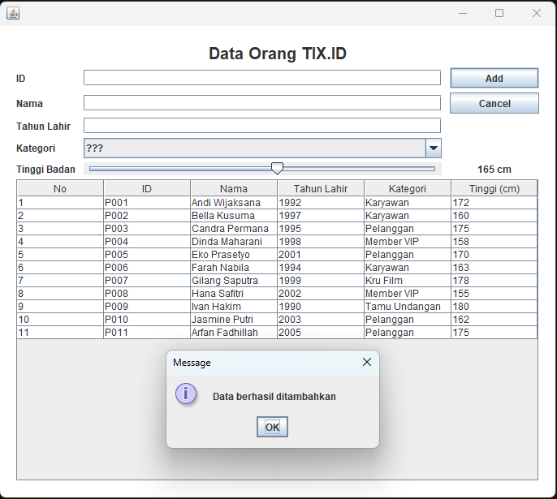
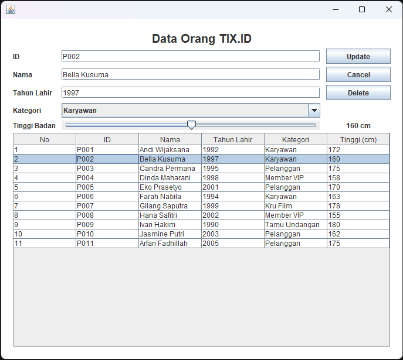
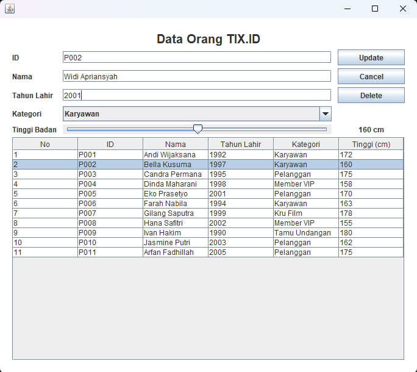
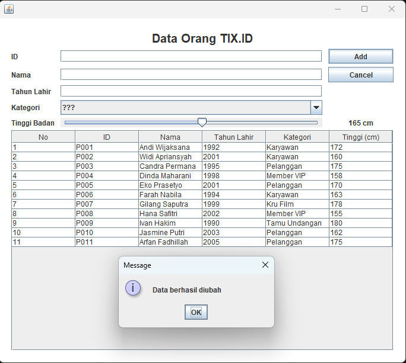
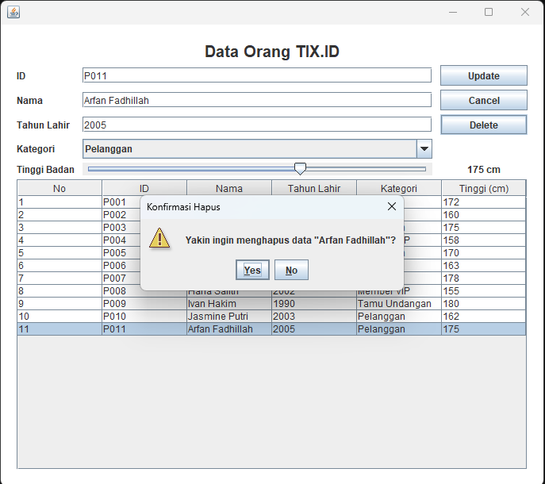
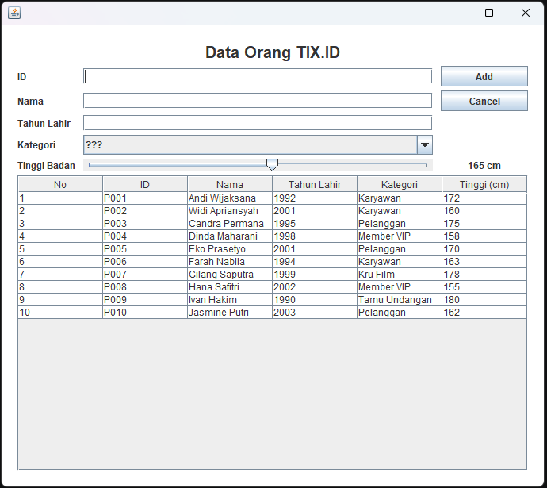
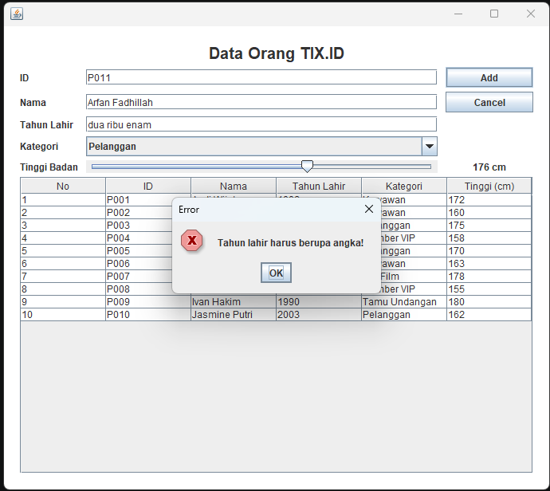

# TP4 DPBO — PeopleData: CRUD Java Swing GUI (TIX.ID)

## 1. Janji

Saya **Hafiz Rifai** dengan **NIM 2508874** mengerjakan Tugas Praktikum 4 dalam mata kuliah Desain dan Pemrograman Berorientasi Objek untuk keberkahanNya maka saya tidak melakukan kecurangan seperti yang telah dispesifikasikan. Aamiin.

---

## 2. Catatan Penggunaan AI

Saya menggunakan bantuan AI (Claude) untuk membantu menuliskan kode program (`Person.java`, `PeopleMenu.java`, dan `PeopleMenu.form`) serta menyusun README ini.

---

## 3. Struktur Folder

```text
TP4DPBO2526C1/
├── PeopleData/                 (folder project IntelliJ)
│   └── src/
│       ├── Person.java
│       ├── PeopleMenu.java
│       └── PeopleMenu.form
├── Dokumentasi/                (screenshot yang ditampilkan di README)
├── .gitignore
└── README.md
```

---

## 4. Desain & Fungsi Program

### 4.1 Gambaran Umum

**PeopleData** adalah aplikasi desktop berbasis **Java Swing GUI** untuk mengelola data orang di lingkungan **TIX.ID Cinema** (melanjutkan tema TP sebelumnya). Aplikasi mendukung operasi **CRUD** lengkap:

| Operasi | Cara di aplikasi |
| ------- | ----------------- |
| **Create** | Isi form lalu tekan tombol **Add** |
| **Read**   | Seluruh data tampil di tabel; klik satu baris untuk melihat detailnya di form |
| **Update** | Klik baris, ubah isi form, lalu tekan tombol **Update** |
| **Delete** | Klik baris, tekan **Delete**, lalu konfirmasi lewat dialog **Yes/No** |

Strukturnya mengikuti latihan `ProductData`, tetapi dengan tema **People** (class `Person` + `PeopleMenu`).

### 4.2 Diagram Class



### 4.3 Class `Person`

Class data yang merepresentasikan satu orang.

| Atribut       | Tipe   | Keterangan |
| ------------- | ------ | ---------- |
| `id`          | String | ID unik orang (contoh: `P001`) |
| `nama`        | String | Nama lengkap |
| `tahunLahir`  | int    | Tahun lahir |
| `kategori`    | String | Peran di TIX.ID: Karyawan, Pelanggan, Member VIP, Kru Film, Tamu Undangan |
| `tinggiBadan` | int    | **Atribut baru** — tinggi badan dalam cm |

Method: constructor kosong & berparameter, serta getter/setter untuk setiap atribut.

### 4.4 Class `PeopleMenu` (extends `JFrame`)

Class ini mengatur tampilan form (`PeopleMenu.form`) sekaligus logika program.

**Komponen form** (nama field sama dengan properti *field name* di `PeopleMenu.form`):

| Field | Komponen | Fungsi |
| ----- | -------- | ------ |
| `mainPanel` | JPanel | Panel utama (dipasang sebagai content pane window) |
| `titleLabel` | JLabel | Judul aplikasi |
| `idField` | JTextField | Input ID |
| `namaField` | JTextField | Input nama |
| `tahunLahirField` | JTextField | Input tahun lahir |
| `kategoriComboBox` | JComboBox | Pilihan kategori |
| `tinggiSlider` | **JSlider** | Input tinggi badan (100–220 cm) — komponen untuk atribut baru |
| `tinggiValueLabel` | JLabel | Menampilkan nilai slider saat ini |
| `addUpdateButton` | JButton | Tombol **Add** (mode tambah) atau **Update** (mode ubah) |
| `deleteButton` | JButton | Tombol hapus (hanya muncul saat ada baris dipilih) |
| `cancelButton` | JButton | Membatalkan/mengosongkan form |
| `peopleTable` | JTable | Menampilkan seluruh data |

**Data:** `listPerson` (`ArrayList<Person>`) menyimpan semua data, dan `selectedIndex` menyimpan baris yang sedang dipilih (`-1` = tidak ada).

**Method:**

| Method | Fungsi |
| ------ | ------ |
| `main()` | Membuat window, mengatur ukuran/posisi/warna, dan menampilkannya |
| `PeopleMenu()` (constructor) | Menginisialisasi list, mengisi data awal & tabel, mengisi combo box & slider, serta mendaftarkan semua listener |
| `populateList()` | Mengisi 10 data awal (hardcoded) |
| `setTable()` | Membuat model tabel dari isi `listPerson` (sel tidak bisa diedit langsung) |
| `insertData()` | **Create** — validasi input lalu menambah `Person` baru ke list |
| `updateData()` | **Update** — validasi input lalu mengubah `Person` di `selectedIndex` lewat setter |
| `deleteData()` | **Delete** — menghapus `Person` di `selectedIndex` dari list |
| `clearForm()` | Mengosongkan form, mengembalikan tombol ke mode **Add**, dan menyembunyikan **Delete** |
| `isInputValid()` | Memvalidasi input (lihat bagian 4.5) |

### 4.5 Fitur Tambahan (sesuai Tugas Praktikum)

1. **Konfirmasi sebelum delete** — menekan **Delete** memunculkan dialog *"Yakin ingin menghapus data ...?"* dengan pilihan Yes/No. Data hanya terhapus jika user memilih **Yes**.
2. **Atribut baru: Tinggi Badan (`tinggiBadan`)** — ditambahkan di class `Person` (atribut + getter/setter), di form (komponen **JSlider** + label nilai), di tabel (kolom *Tinggi (cm)*), dan di logika `PeopleMenu` (insert, update, klik baris, dan clear form). Karena komponennya **bukan JTextField**, fitur ini memenuhi syarat **bonus**.
3. **Validasi input** — pesan error muncul jika: tahun lahir bukan angka, tahun lahir di luar rentang 1900 – tahun sekarang, ID/nama kosong, kategori belum dipilih (`???`), atau ID sudah dipakai orang lain.

---

## 5. Penjelasan Alur Program

1. **Program dijalankan** — `main()` membuat objek `PeopleMenu`. Constructor-nya mengisi `listPerson` lewat `populateList()` (10 data), menampilkannya ke tabel lewat `setTable()`, mengisi combo box kategori dan slider, menyembunyikan tombol **Delete**, lalu mendaftarkan listener untuk tombol, slider, dan tabel. Window kemudian ditampilkan.
2. **Read (melihat data)** — tabel selalu dibangun dari `listPerson` oleh `setTable()`. Saat sebuah baris diklik, `selectedIndex` diisi nomor baris tersebut, form terisi dengan data orang itu (termasuk kategori dan slider), tombol **Add** berubah menjadi **Update**, dan tombol **Delete** muncul.
3. **Create (menambah data)** — saat tidak ada baris dipilih (`selectedIndex == -1`), tombol **Add** memanggil `insertData()`: data form diambil → divalidasi → `Person` baru ditambahkan ke list → tabel di-refresh → form dibersihkan → dialog "Data berhasil ditambahkan" muncul.
4. **Update (mengubah data)** — saat sebuah baris dipilih (`selectedIndex != -1`), tombol **Update** memanggil `updateData()`: data form diambil → divalidasi (ID boleh sama dengan ID miliknya sendiri) → atribut `Person` di list diubah lewat setter → tabel di-refresh → form dibersihkan → dialog "Data berhasil diubah" muncul.
5. **Delete (menghapus data)** — tombol **Delete** menampilkan dialog konfirmasi. Jika **Yes**, `deleteData()` menghapus `Person` dari list, me-refresh tabel (nomor urut tersusun ulang), membersihkan form, dan menampilkan dialog "Data berhasil dihapus". Jika **No**, tidak terjadi apa-apa.
6. **Cancel** — tombol **Cancel** memanggil `clearForm()` sehingga form kosong, tombol kembali ke mode **Add**, dan pilihan baris dibatalkan.

---

## 6. Cara Menjalankan

1. Buka folder `PeopleData` sebagai project di **IntelliJ IDEA** (pastikan plugin **Swing UI Designer** sudah terpasang).
2. Buka file `PeopleMenu.java`.
3. Klik ikon **Run** hijau di samping `public static void main`, atau tekan `Ctrl + Shift + F10`.

---

## 7. Dokumentasi

### 7.1 Read — Tampilan awal (10 data awal)



### 7.2 Create — Menambah data

Mengisi form (termasuk combo box kategori dan slider tinggi badan):



Hasil setelah menekan **Add** (dialog sukses muncul dan data baru tampil di tabel):



### 7.3 Read — Memilih satu baris

Klik satu baris tabel: form terisi, tombol berubah menjadi **Update**, dan tombol **Delete** muncul.



### 7.4 Update — Mengubah data

Mengubah isi form:



Hasil setelah menekan **Update**:



### 7.5 Delete — Menghapus data (dengan konfirmasi)

Dialog konfirmasi muncul setelah menekan **Delete**:



Hasil setelah memilih **Yes**:



### 7.6 Validasi input

Contoh pesan error saat tahun lahir bukan angka:


